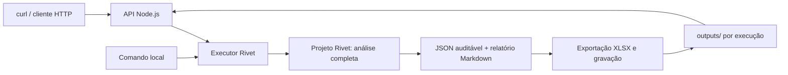

# Case Enter — análise de sentenças com Rivet

Modelagem de uma solução que transforma as sentenças fornecidas em dados auditáveis, valores atualizados para maio/2026, recomendações econômicas de recurso e um relatório executivo.

**Estado atual:** especificação anterior à implementação. O repositório contém os insumos originais, o projeto-base da Enter, a arquitetura, os contratos e os critérios de validação. A API, o fluxo completo e os documentos finais ainda serão construídos; os exemplos HTTP abaixo são contratos planejados.

**Prazo informado no convite:** 16/10/2026, às 23:59. O convite não explicita o fuso. Meta interna: pacote reproduzível em 15/10, com 16/10 reservado para revisão e envio antecipado.

## Solução escolhida

Uma API **Node.js**, acessível por POST e GET, executará o arquivo `.rivet-project` usando `@ironclad/rivet-node`. Toda a análise — extração, validação, cruzamentos, cálculo financeiro, recomendação e consolidação — ficará no grafo Rivet. O exportador apenas materializará os outputs em arquivos.



Node.js é o ambiente de execução no servidor. A solução usa uma única aplicação, sem frontend e sem banco de dados. O arquivo Rivet será a fonte das regras de análise, executável tanto pelo aplicativo visual quanto pelo executor. A configuração desses dois caminhos será verificada na primeira fatia.

## Documentos de trabalho

| Documento | Uso |
| --- | --- |
| [RFC](docs/RFC.md) | Arquitetura, limites, decisões e alternativas. |
| [Contratos](docs/CONTRATOS.md) | Entradas, extração, dinheiro, decisões, execução e HTTP. |
| [Schema de extração](schemas/extracao.schema.json) | Contrato formal da resposta estruturada por sentença. |
| [Plano de execução](docs/PLANO_DE_EXECUCAO.md) | Fatias completas, critérios de saída e calendário. |
| [Matriz de validação](docs/MATRIZ_VALIDACAO.md) | Requisitos do case, testes previstos e referências conferidas do lote. |
| [Guia de engenharia](guia_definitivo_de_engenharia_e_arquitetura.md) | Referência metodológica, adaptada a este case. |

Os materiais recebidos estão em `case/`, inclusive o PDF do enunciado, `challenge_enter.rivet-project` e os cinco arquivos de `Input/`. Esses originais são preservados. A primeira fatia preparará uma cópia de trabalho em `rivet/` e entradas com caminhos portáveis.

## Como será utilizado

Após a implementação e a inicialização do servidor, o contrato previsto é:

```bash
curl -X POST http://127.0.0.1:3000/execucoes -H 'Content-Type: application/json' -d '{"dataset":"case"}'
```

A resposta `202 Accepted` conterá `execucao_id` e `status_url`. O cliente consultará `GET /execucoes/{execucao_id}` e obterá os links dos arquivos concluídos. Cada execução terá um diretório próprio, evitando sobrescrever resultados anteriores.

Os comandos de instalação, teste e execução serão acrescentados quando existirem e tiverem sido verificados em uma instalação limpa. A versão do Node e as dependências serão fixadas após o teste de compatibilidade com a versão Rivet utilizada.

## Configuração e credenciais

[`.env.example`](.env.example) documenta a configuração prevista sem credenciais. A chave do provedor deve ser configurada localmente ou no ambiente de execução. `.env`, logs e resultados locais estão excluídos do Git; o empacotamento final usará uma lista explícita de arquivos. O modelo será escolhido após testar acesso, compatibilidade, qualidade, tempo e consumo; a existência de uma chave não comprova acesso a qualquer modelo.

## Critério de entrega

- Projeto Rivet funcional e todos os insumos necessários para reproduzir a análise.
- Planilha `.xlsx`, com uma linha por processo, valores e recomendação explicáveis.
- Relatório executivo gerado a partir dos resultados, com números reconciliados e limitações visíveis.
- Racional próprio do candidato, com até duas páginas, consistente com o que foi implementado e medido.
- Evidências de validação e instruções de reprodução, além da API como facilidade de uso.

As referências de 100 processos, 48 vitórias e 52 condenações vêm da inspeção dos insumos. Elas são um controle de validação, não uma execução bem-sucedida do futuro pipeline. Pendências e métricas não medidas devem aparecer como tais.

## Referências técnicas

- [Instalação da Rivet](https://rivet.ironcladapp.com/docs/getting-started/installation).
- [Execução de projetos com runGraphInFile](https://rivet.ironcladapp.com/docs/api-reference/node/runGraphInFile).
- [Code Nodes para lógica determinística](https://rivet.ironcladapp.com/docs/node-reference/code).
- [Servidor HTTP nativo da Rivet](https://rivet.ironcladapp.com/docs/cli/serve), alternativa para experimentação; a API planejada acrescenta estado de execução e download dos artefatos.
