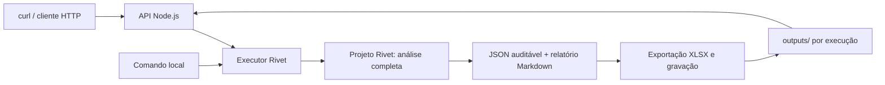

# Case Enter — análise de sentenças com Rivet

Modelagem de uma solução que transforma as sentenças fornecidas em dados auditáveis, valores atualizados para maio/2026, recomendações econômicas de recurso e um relatório executivo.

**Estado atual:** S4 concluída: API Node.js funcional, executor compartilhado com CLI e 175 testes aprovados. POST, consulta, downloads, concorrência e reinício verificados; curl real reproduziu os 100 casos sem chamada paga. S3 V0 aceita visualmente. [Validação e comandos S4](docs/validacao/S4_VALIDACAO.md). PDF executivo e ZIP ficam na S5.

**Prazo informado no convite:** 16/10/2026, às 23:59. O convite não explicita o fuso. Meta interna: pacote reproduzível em 15/10, com 16/10 reservado para revisão e envio antecipado.

## Solução escolhida

Uma API **Node.js**, acessível por POST e GET, executa o arquivo `.rivet-project` usando `@ironclad/rivet-node`. Toda a análise — extração, validação, cruzamentos, cálculo financeiro, recomendação e consolidação — fica no grafo Rivet. O exportador apenas materializa os outputs em arquivos.



Node.js é o ambiente de execução no servidor. A solução usa uma única aplicação, sem frontend e sem banco de dados. O arquivo Rivet será a fonte das regras de análise, executável tanto pelo aplicativo visual quanto pelo executor. A configuração desses dois caminhos será verificada na primeira fatia.

## Documentos de trabalho

| Documento | Uso |
| --- | --- |
| [RFC](docs/arquitetura/RFC.md) | Arquitetura, limites, decisões e alternativas. |
| [Contratos](docs/arquitetura/CONTRATOS.md) | Entradas, extração, dinheiro, decisões, execução e HTTP. |
| [Schema de extração](schemas/extracao.schema.json) | Contrato formal da resposta estruturada por sentença. |
| [Plano de execução](docs/PLANO_DE_EXECUCAO.md) | Fatias completas, critérios de saída e calendário. |
| [Matriz de validação](docs/validacao/MATRIZ_VALIDACAO.md) | Requisitos do case, testes previstos e referências conferidas do lote. |
| [Validação S0](docs/validacao/S0_VALIDACAO.md) | Resultados medidos e reprodução no SDK e no aplicativo. |
| [Outputs de validação](docs/output/README.md) | Evidências preservadas das execuções e conferências. |
| [Gabaritos](tests/fixtures/README.md) | 12 casos de desenvolvimento e 12 reservados, método de seleção e conferência. |
| [Guia de engenharia](guia_definitivo_de_engenharia_e_arquitetura.md) | Referência metodológica, adaptada a este case. |

Os materiais recebidos estão em `case/`, inclusive o PDF do enunciado, `challenge_enter.rivet-project` e os cinco arquivos de `Input/`. Esses originais são preservados. A cópia de trabalho está em `rivet/analise_sentencas.rivet-project`; o projeto separado `rivet/s0_compatibilidade.rivet-project` contém as provas S0 com entradas padrão embutidas e sem caminhos absolutos.

## Executar a S0

Com Node **20.20.2** (fixado em `.nvmrc`), na raiz do repositório:

```bash
nvm use
npm ci --ignore-scripts
npm run s0:build
npm test
npm run s0:check
```

`s0:check` grava `outputs/s0/calculo.json`, `validacao.json` e `prova.xlsx`, reabrindo a planilha para conferir as células. São artefatos da prova de integração; a carteira completa será processada em S3.

Para uma chamada real, configure `OPENAI_API_KEY` no `.env` local e rode `npm run s0:llm`. Sem `LLM_MODEL`, o comando usa `gpt-4.1-mini-2025-04-14`, validado na S0. Os demais comandos acima são offline. Consulte as [instruções para o aplicativo](docs/validacao/S0_VALIDACAO.md#como-reproduzir-a-conferência-no-rivet) para reproduzir a conferência já concluída.

## Como será utilizado

A S1 está sendo desenvolvida uma tarefa por vez. A **S1.2** implementou o grafo `analisar_carteira` para uma condenação; `npm run test:s1:grafo` aprova 11 testes. A **S1.3** implementou o XLSX: `npm run test:s1` passa os dois testes de aceitação e `npm run test:s1:xlsx` passa os sete cenários específicos do exportador. `npm test` executa agora os 175 testes de S0–S4; `npm run test:s0` mantém a execução isolada da S0. Consulte [S1_TASKS.md](docs/desenvolvimento/S1_TASKS.md) para revisar escopo, contratos e os próximos commits.

Com o servidor iniciado conforme a seção S4 abaixo, o POST é:

```bash
curl -X POST http://127.0.0.1:3000/execucoes -H 'Content-Type: application/json' -d '{"dataset":"case"}'
```

A resposta `202 Accepted` conterá `execucao_id` e `status_url`. O cliente consultará `GET /execucoes/{execucao_id}` e obterá os links dos arquivos concluídos. Cada execução terá um diretório próprio, evitando sobrescrever resultados anteriores.

Os comandos da API foram implementados e verificados na S4. A CLI S1 processa uma sentença; a CLI S3 processa a carteira completa e exporta os resultados, incluindo eventuais pendências.

## Configuração e credenciais

[`.env.example`](.env.example) documenta a configuração prevista sem credenciais. A chave do provedor deve ser configurada localmente ou no ambiente de execução. `.env`, logs e resultados locais estão excluídos do Git; o empacotamento final usará uma lista explícita de arquivos. O modelo será escolhido após testar acesso, compatibilidade, qualidade, tempo e consumo; a existência de uma chave não comprova acesso a qualquer modelo.

## Critério de entrega

- Projeto Rivet funcional e todos os insumos necessários para reproduzir a análise.
- Planilha `.xlsx`, com uma linha por processo, valores e recomendação explicáveis.
- Relatório executivo gerado a partir dos resultados, com números reconciliados e limitações visíveis.
- Racional próprio do candidato, com até duas páginas, consistente com o que foi implementado e medido.
- Evidências de validação e instruções de reprodução, além da API como facilidade de uso.

As referências de 100 processos, 48 vitórias e 52 condenações vêm da inspeção dos insumos. Elas são um controle de validação, não uma execução bem-sucedida do futuro pipeline. Pendências e métricas não medidas devem aparecer como tais.

## Referências técnicas

- [Instalação da Rivet](https://rivet.ironcladapp.com/docs/getting-started/installation).
- [Execução de projetos com runGraphInFile](https://rivet.ironcladapp.com/docs/api-reference/node/runGraphInFile).
- [Code Nodes para lógica determinística](https://rivet.ironcladapp.com/docs/node-reference/code).
- [Servidor HTTP nativo da Rivet](https://rivet.ironcladapp.com/docs/cli/serve), alternativa para experimentação; a API planejada acrescenta estado de execução e download dos artefatos.

Para revisar a S1.2, veja [validação e execução](docs/validacao/S1_2_VALIDACAO.md). `npm run s1:build` recompõe o grafo a partir dos fontes; `npm run s1:avaliar` faz até três chamadas reais pagas para um único caso e grava a evidência em `outputs/s1.2/`. Os registros revisados ficam em `docs/output/`.

A [validação S1.3](docs/validacao/S1_3_VALIDACAO.md) inclui a planilha de exemplo e a reprodução offline. Grafo e exportador estão conectados pela S1.4.

## Executar a S1 integrada

```bash
npm run s1:executar -- --replay
npm run test:s1:execucao
```

O primeiro comando executa o grafo com a resposta real capturada na S1.2, sem rede, e gera JSONs, relatório e XLSX em `outputs/s1.4/<execucao_id>/`. O manifesto registra o modo de reprodução e os hashes. O segundo verifica sete cenários de integração. Para uma nova execução paga (até três chamadas), use `node --env-file=.env scripts/executar-s1.mjs --real`. Escopo atual: uma sentença de desenvolvimento. Consulte [S1_4_VALIDACAO.md](docs/validacao/S1_4_VALIDACAO.md) para parâmetros, arquivos, evidências e limites.

A [revisão S1.5](docs/validacao/S1_5_VALIDACAO.md) descreve os cinco subgrafos e o roteiro de aceite no aplicativo. Para validar todo o desenvolvimento local, execute `npm test`.

## S2 por tarefa

A [S2.1](docs/desenvolvimento/S2_TASKS.md) adiciona 13 cenários offline para os quatro resultados e um pedido sintético maior. Na S2.1, seis cenários ficaram em vermelho. A [S2.2](docs/validacao/S2_2_VALIDACAO.md) implementou as vitórias: `npm run test:s2` passa os 13 cenários e `npm test` passou todos os 56 testes daquela etapa. A S2.4 amplia a suíte para 84 testes.

## Onde ficam os outputs

No painel Rivet, este grafo mostra resultados nos quatro nós Graph Output; ele não grava automaticamente JSON, Markdown ou XLSX no disco. Quem grava arquivos é o comando Node, cujo resultado informa o diretório criado em `outputs/s1.4/<execucao_id>/` (ou na raiz passada com `--destino`). `--replay` usa uma captura anterior, não importa a execução recém-feita no painel. `node --env-file=.env scripts/executar-s1.mjs --real` executa novamente o grafo (até três chamadas pagas) e salva seus resultados. Os registros selecionados para revisão ficam em `docs/output/`.

A documentação está organizada por finalidade em [docs/README.md](docs/README.md). O [plano](docs/PLANO_DE_EXECUCAO.md) mantém IDs em todas as tarefas. `npm run test:s2:incertezas` executa os 20 contratos da S2.3, agora verdes e incluídos em `npm test`. Consulte [implementação, resultados e instalação do plugin](docs/validacao/S2_4_VALIDACAO.md).


## Fronteiras e cobertura S2.5

`npm run test:s2:fronteiras` executa 25 cenários de calendário e dinheiro. `npm run test:s2:cobertura` executa 13 cenários de lote, reconciliação e exclusões. Todos integram `npm test` (175 testes, incluindo S4).

`npm run s2:check` gera JSONs, XLSX, relatório e manifesto de um lote misto de sete identidades em `outputs/s2.6/<execucao_id>/`, com transporte inteiramente simulado e sem cobrança. O grafo `analisar_lote` reutiliza a análise individual, sem omitir pendências. Veja [contratos, resultados e roteiro do aplicativo](docs/validacao/S2_5_VALIDACAO.md). A [S2.6](docs/validacao/S2_6_VALIDACAO.md) reconcilia os artefatos com `npm run test:s2:integracao`; a CLI de produção da carteira e sua avaliação completa continuam pendentes.

## Carteira completa — S3

[Planilha](docs/output/s3/processos.xlsx), [relatório executivo](docs/output/s3/relatorio.md), [projeto completo](docs/output/s3/projeto.rivet-project) e [evidências](docs/validacao/S3_VALIDACAO.md). O projeto completo tem insumos embutidos e chama a API ao executar `analisar_lote`. Para conferir no aplicativo sem nova chamada, abra [aceite offline](docs/output/s3/aceite-consolidacao.rivet-project) e execute somente `s2_consolidacao_lote`, com defaults já preenchidos.

```bash
npm test
node --env-file=.env scripts/executar-carteira.mjs --real
```

O segundo comando é uma nova execução paga, com até três tentativas por sentença. O diretório informado contém manifesto, snapshots, checkpoint, JSONs, Markdown e XLSX. Auditoria e métricas são comandos separados documentados na validação S3. O corpus reservado reprovou inicialmente; a correção e a reavaliação de conjunto já visto foram preservadas. Não interpretar a prova como estudo cego ou validação da API futura.

O candidato aprovou visualmente os artefatos S3 como V0. A tarefa S5.10 adaptará o relatório ao modelo executivo escolhido e produzirá PDF, preservando a fonte Markdown e os números do Rivet.

## API local — S4

Para reproduzir a sequência HTTP sem credencial ou chamadas pagas:

```bash
npm run s4:check
```

O comando usa curl real, inicia/encerra servidores locais e grava evidência/downloads em outputs/s4-curl/. Para uso manual, execute `npm run s4:replay`, copie o caminho de captura informado e inicie `npm run api:start -- --replay --captura <caminho>`. Veja [passos de curl, configuração real e limites](docs/validacao/S4_VALIDACAO.md).

Para nova análise paga por POST, inicie `node --env-file=.env scripts/servidor.mjs --real`. O servidor usa 127.0.0.1:3000 por padrão e grava em outputs/api/. Um POST inicia a carteira; GETs consultam/baixam arquivos sem chamar a LLM. Uma execução ativa por instância e diretório exclusivo; reinício marca jobs antigos como interrompidos, sem retomada automática. O relatório publicado é Markdown V0; PDF será integrado na S5.10.
