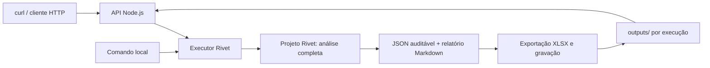

# Case Enter — análise de sentenças com Rivet

Modelagem de uma solução que transforma as sentenças fornecidas em dados auditáveis, valores atualizados para maio/2026, recomendações econômicas de recurso e um relatório executivo.

**Estado atual:** S0 concluída: três grafos de prova, 14 testes aprovados, exportação XLSX conferida e chamada real à OpenAI pelo SDK. O candidato também executou os três grafos no aplicativo Rivet e os outputs enviados foram conferidos. A API, o fluxo completo e os documentos finais ainda serão construídos; os exemplos HTTP abaixo são contratos planejados.

**Prazo informado no convite:** 16/10/2026, às 23:59. O convite não explicita o fuso. Meta interna: pacote reproduzível em 15/10, com 16/10 reservado para revisão e envio antecipado.

## Solução escolhida

Uma API **Node.js**, acessível por POST e GET, executará o arquivo `.rivet-project` usando `@ironclad/rivet-node`. Toda a análise — extração, validação, cruzamentos, cálculo financeiro, recomendação e consolidação — ficará no grafo Rivet. O exportador apenas materializará os outputs em arquivos.



Node.js é o ambiente de execução no servidor. A solução usa uma única aplicação, sem frontend e sem banco de dados. O arquivo Rivet será a fonte das regras de análise, executável tanto pelo aplicativo visual quanto pelo executor. A configuração desses dois caminhos será verificada na primeira fatia.

## Documentos de trabalho

| Documento | Uso |
| --- | --- |
| [RFC](docs/RFC.md) | Arquitetura, limites, decisões e alternativas. |
| [Contratos](docs/CONTRATOS.md) | Entradas, extração, dinheiro, decisões, execução e HTTP. |
| [Schema de extração](schemas/extracao.schema.json) | Contrato formal da resposta estruturada por sentença. |
| [Plano de execução](docs/PLANO_DE_EXECUCAO.md) | Fatias completas, critérios de saída e calendário. |
| [Matriz de validação](docs/MATRIZ_VALIDACAO.md) | Requisitos do case, testes previstos e referências conferidas do lote. |
| [Validação S0](docs/S0_VALIDACAO.md) | Resultados medidos e reprodução no SDK e no aplicativo. |
| [Outputs de validação](docs/output/README.md) | Evidências preservadas das execuções e conferências. |
| [Gabaritos](tests/fixtures/README.md) | 12 casos de desenvolvimento e 12 reservados, método de seleção e conferência. |
| [Guia de engenharia](guia_definitivo_de_engenharia_e_arquitetura.md) | Referência metodológica, adaptada a este case. |

Os materiais recebidos estão em `case/`, inclusive o PDF do enunciado, `challenge_enter.rivet-project` e os cinco arquivos de `Input/`. Esses originais são preservados. A cópia de trabalho está em `rivet/analise_sentencas.rivet-project`; o projeto separado `rivet/s0_compatibilidade.rivet-project` contém as provas S0 com entradas padrão embutidas e sem caminhos absolutos.

## Executar a S0

Com Node **20.20.2** (fixado em `.nvmrc`), na raiz do repositório:

```bash
nvm use
npm ci --ignore-scripts
npm run s0:build
npm test
npm run s0:check
```

`s0:check` grava `outputs/s0/calculo.json`, `validacao.json` e `prova.xlsx`, reabrindo a planilha para conferir as células. São artefatos da prova de integração; a carteira completa será processada em S3.

Para uma chamada real, configure `OPENAI_API_KEY` no `.env` local e rode `npm run s0:llm`. Sem `LLM_MODEL`, o comando usa `gpt-4.1-mini-2025-04-14`, validado na S0. Os demais comandos acima são offline. Consulte as [instruções para o aplicativo](docs/S0_VALIDACAO.md#como-reproduzir-a-conferência-no-rivet) para reproduzir a conferência já concluída.

## Como será utilizado

A S1 está sendo desenvolvida uma tarefa por vez. A **S1.1** adicionou os testes de aceitação; `npm run test:s1` apresenta duas falhas esperadas porque o grafo de análise e o exportador definitivo ainda não existem. `npm test` continua executando os 14 testes da S0. Consulte [S1_TASKS.md](docs/S1_TASKS.md) para revisar escopo, contratos e os próximos commits.

Após a implementação e a inicialização do servidor, o contrato previsto é:

```bash
curl -X POST http://127.0.0.1:3000/execucoes -H 'Content-Type: application/json' -d '{"dataset":"case"}'
```

A resposta `202 Accepted` conterá `execucao_id` e `status_url`. O cliente consultará `GET /execucoes/{execucao_id}` e obterá os links dos arquivos concluídos. Cada execução terá um diretório próprio, evitando sobrescrever resultados anteriores.

Os comandos da API serão acrescentados em S4 após implementação e verificação. O executor e os comandos atuais validam somente a preparação S0.

## Configuração e credenciais

[`.env.example`](.env.example) documenta a configuração prevista sem credenciais. A chave do provedor deve ser configurada localmente ou no ambiente de execução. `.env`, logs e resultados locais estão excluídos do Git; o empacotamento final usará uma lista explícita de arquivos. O modelo será escolhido após testar acesso, compatibilidade, qualidade, tempo e consumo; a existência de uma chave não comprova acesso a qualquer modelo.

## Critério de entrega

- Projeto Rivet funcional e todos os insumos necessários para reproduzir a análise.
- Planilha `.xlsx`, com uma linha por processo, valores e recomendação explicáveis.
- Relatório executivo gerado a partir dos resultados, com números reconciliados e limitações visíveis.
- Racional próprio do candidato, com até duas páginas, consistente com o que foi implementado e medido.
- Evidências de validação e instruções de reprodução, além da API como facilidade de uso.

As referências de 100 processos, 48 vitórias e 52 condenações vêm da inspeção dos insumos. Elas são um controle de validação, não uma execução bem-sucedida do futuro pipeline. Pendências e métricas não medidas devem aparecer como tais.

## Referências técnicas

- [Instalação da Rivet](https://rivet.ironcladapp.com/docs/getting-started/installation).
- [Execução de projetos com runGraphInFile](https://rivet.ironcladapp.com/docs/api-reference/node/runGraphInFile).
- [Code Nodes para lógica determinística](https://rivet.ironcladapp.com/docs/node-reference/code).
- [Servidor HTTP nativo da Rivet](https://rivet.ironcladapp.com/docs/cli/serve), alternativa para experimentação; a API planejada acrescenta estado de execução e download dos artefatos.
