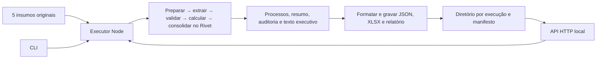

# Arquitetura — análise de sentenças com Rivet

Implementei a solução com um projeto Rivet, um executor Node e exportadores de arquivos. A API local usa o mesmo executor da CLI. Escolhi arquivos por execução porque o lote cabe em memória e a entrega precisa ser reproduzível; um banco de dados não resolveria uma necessidade deste case.

## Responsabilidades

No aplicativo, uso os Graph Inputs textuais do projeto completo, já preenchidos com os insumos da entrega. Não implementei um grafo separado de leitura de arquivos. Na CLI/API, Node lê os cinco arquivos e passa seus conteúdos para as mesmas entradas do grafo. Não deixei caminhos absolutos nos defaults.

| Componente | Responsabilidade |
| --- | --- |
| `analisar_lote` | Preparar e conferir referências, executar cada sentença e reconciliar a carteira. |
| `analisar_carteira` | Analisar uma sentença; o nome foi mantido por compatibilidade com a S1. |
| Subgrafos S1 | Preparação, extração, validação, cálculo financeiro e consolidação individual. |
| Plugin local | Transporte limitado da extração e execução sequencial dos subgrafos. |
| `s2_consolidacao_lote` | Conferir identidades, somar valores, produzir distribuições e texto executivo. |
| Executor Node | Transporte, eventos, snapshots, checkpoint, timeout e gravação. |
| Exportadores | Apresentar os resultados recebidos, sem calcular condenações ou recomendações. |
| API | POST de início, GET de estado e download de artefatos íntegros. |

## Escolhas e alternativas

Preferi Node a FastAPI para executar diretamente o SDK Rivet, com um único runtime. Evitei frontend e banco: o cliente HTTP e os arquivos atendem à interface deste case. Mantive as regras financeiras em Code Nodes, com frações `BigInt`, porque preciso de centavos exatos e memória de cálculo. Não pedi aritmética à LLM.

Extraio uma sentença por chamada para localizar omissões, limitar retentativas e preservar evidências por identidade. Um schema correto não basta: verifico também a consistência com o dispositivo. Desconhecido permanece nulo; zero conhecido exige suporte no documento. Falhas individuais conservam a linha; falhas globais impedem novas recomendações.

O lote é sequencial. Limitei a extração a três tentativas totais, dez segundos por chamada e quarenta segundos por sentença; a carteira tem timeout de trinta minutos. A auditoria registra cada tentativa, inclusive respostas rejeitadas. Esta escolha prioriza controle para o volume recebido, sem reivindicar escala de produção.

## Persistência e HTTP

O manifesto inicial é gravado antes do `202`. Publico arquivos completos, com escrita temporária, renomeação e hash SHA-256. Cada execução conserva sua identificação, entradas, projeto, schemas, plugin, checkpoint e outputs. A API atende uma execução ativa por instância e reserva o diretório com lock local.

| Rota | Comportamento |
| --- | --- |
| `POST /execucoes` | Aceita somente `{"dataset":"case"}`. Retorna 202 e URL de consulta. |
| `GET /execucoes/{id}` | Retorna estado, contagem disponível, resumo e links dos artefatos. |
| `GET /execucoes/{id}/artefatos/{nome}` | Confere whitelist, manifesto, arquivo regular e hash antes de enviar. |

JSON malformado retorna 400; contrato inválido, 422; corpo acima de 8192 bytes, 413; execução concorrente, 409; configuração ausente, 503. GET não inicia nova análise. POST repetido após conclusão inicia outra execução: não implementei chave de idempotência.

Após crash/reinício, marco jobs deixados ativos como interrompidos e preservo seus checkpoints. Não retomo automaticamente nem coordeno múltiplos hosts. Uso `127.0.0.1` por padrão; autenticação, upload e operação pública ficam fora do escopo implementado.

## Verificação e entrega

Apliquei o guia por meio de contratos, fatias completas e testes de entrada/saída, preservando os vermelhos observados. A API é um extra; os requisitos centrais continuam sendo o projeto, os insumos, a planilha, o relatório executivo e o racional. A execução real e a avaliação da LLM têm registros separados dos testes offline e dos replays.

Documentei detalhes normativos em [contratos](CONTRATOS.md), resultados em [validação final](../entrega/validacao.md) e estado das tarefas no [plano](../PLANO_DE_EXECUCAO.md). Conservo as falhas históricas e as limitações: a repetição reservada não é cega, a auditoria não tem segundo revisor humano e as probabilidades do CSV não foram calibradas neste lote.
