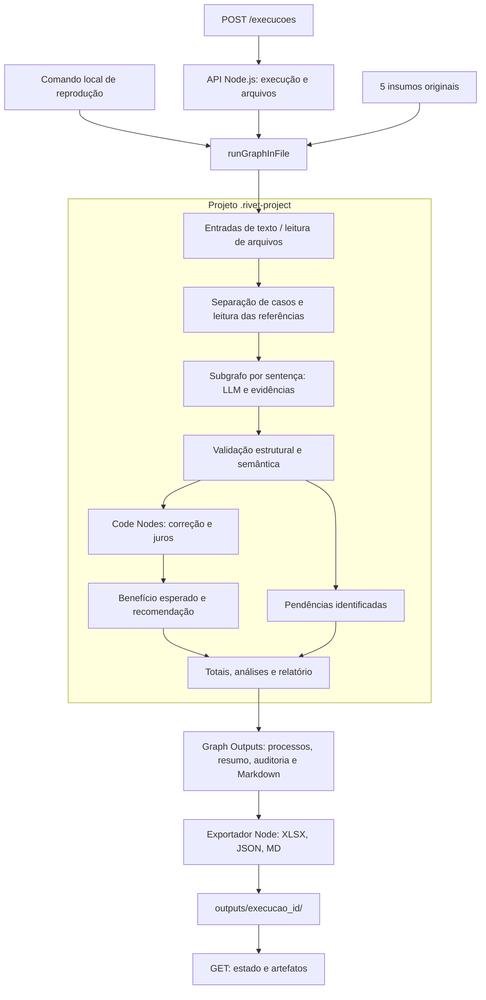
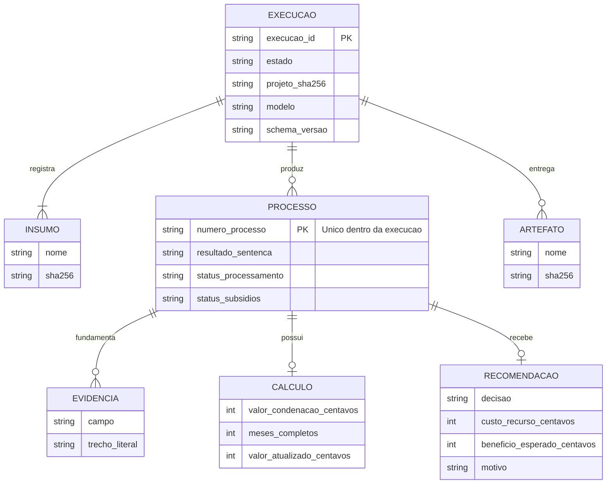

# RFC — análise de sentenças na Rivet e entrega por API Node.js

**Versão:** 0.2 — modelagem revisada em 11/10/2026.

**Estado:** especificado; implementação e medições pendentes.

**Objetivo:** cumprir os entregáveis do case com execução reproduzível e recomendações auditáveis. A RFC é documentação interna; o racional final terá até duas páginas.

## SEÇÃO 1: CONTEXTUALIZAÇÃO

### 1.1 Problema, resultado esperado e prioridade

O cliente precisa conhecer o êxito da carteira, o impacto das condenações e os casos em que o benefício econômico esperado de recorrer supera o custo. A referência financeira é **31/05/2026**, independentemente da data de execução do programa.

O enunciado exige que todo o fluxo de análise seja construído na Rivet. A API é uma facilidade para iniciar e acompanhar esse fluxo. A prioridade de entrega é: projeto Rivet funcional, dados corretos, relatório útil, reprodução e acabamento.

A inspeção do lote identificou 100 processos únicos: 35 procedências, 17 procedências parciais, 26 improcedências e 22 extinções. Todos são do TJSP e da comarca de São Paulo. As 52 condenações têm mês-base e citação explícitos. As contagens e suas limitações estão na [matriz de validação](../validacao/MATRIZ_VALIDACAO.md).

### 1.2 Arquitetura e responsabilidades

| Componente | Responsabilidade |
| --- | --- |
| API Node.js | Validar a solicitação, criar a execução, acionar o executor, persistir estado e servir os arquivos. |
| Executor Node.js | Carregar o projeto, passar entradas e configuração, receber outputs e tratar término/erro. API e comando local compartilham esse executor. |
| Grafo Rivet | Interpretar os insumos, extrair, validar, calcular, decidir e produzir dados consolidados e texto executivo. |
| Exportador | Gravar os outputs e formatar células, abas e cabeçalhos; valores, totais e recomendações chegam calculados. |
| Arquivos por execução | Preservar snapshots de entrada, manifesto, outputs e evidências. Escrita temporária seguida de renomeação para evitar arquivos finais incompletos. |

O [SDK oficial](https://rivet.ironcladapp.com/docs/api-reference/node/runGraphInFile) executa o projeto em Node e retorna os Graph Outputs. Assim, uma única aplicação atende POSTs e GETs, sem frontend. Os [Code Nodes](https://rivet.ironcladapp.com/docs/node-reference/code) comportam a lógica determinística no grafo, mas não importam bibliotecas npm; a implementação deve respeitar esse limite.

O grafo principal terá entradas textuais explícitas para os cinco insumos. Um grafo de entrada para o aplicativo visual lerá arquivos configuráveis e chamará esse mesmo grafo principal. Evitar caminhos absolutos da máquina do autor e dependências de funções externas na análise. O exportador faz a conversão física dos outputs; ele acompanha a entrega e deve funcionar a partir de outputs exportados da Rivet.

O item 5.4 permite gerar o relatório dentro ou a partir de um output Rivet. A separação entre análise no grafo e formatação externa é a interpretação adotada para a entrega e será explicada no racional. A primeira fatia deve demonstrar esse percurso completo.

### 1.3 Alternativas e trade-offs

| Alternativa descartada nesta versão | Descartada porque... | Ganharia se... |
| --- | --- | --- |
| FastAPI com executor Node separado | Acrescenta outro runtime à aplicação; o candidato também tem experiência em Node. | Houvesse infraestrutura Python existente que precisássemos integrar. |
| SQLite ou PostgreSQL | O lote e as referências cabem em memória; arquivos por execução atendem à reprodução. | Precisássemos consultar muitas execuções ou compartilhar atualizações concorrentes. |
| Motor financeiro externo ao grafo | Desloca parte central da análise para fora da ferramenta exigida. | O cliente permitisse explicitamente essa divisão em outro contexto. |
| Aritmética feita pela LLM | A geração de texto não garante aplicação exata de fórmulas. | O objetivo fosse uma explicação qualitativa, sem cálculo contábil. |
| Todo o arquivo em uma única chamada LLM | Dificulta localizar omissões, retentar um caso e controlar truncamento. | Um experimento comprovasse vantagem sem reduzir cobertura e rastreabilidade. |
| Apenas o servidor HTTP nativo Rivet | Já oferece POST, mas o projeto também precisa acompanhar o lote e servir artefatos. | A entrega exigisse somente uma resposta JSON síncrona. |

### 1.4 Aplicação do guia e dos valores apresentados

O guia orienta especificação antes do código, contratos explícitos, fatias completas e testes de caixa-preta. O modelo de banco do exemplo bancário é substituído por contratos de arquivos; os testes observam os outputs do grafo e, posteriormente, a API HTTP real. Testes determinísticos e avaliações reais de extração são separados.

Senso de urgência significa antecipar uma sentença completa funcionando. Deliver Wow será demonstrado por artefatos conciliados e úteis à diretoria. Immediate Candor exige falhas, hipóteses e métricas não medidas visíveis. United Front se traduz em reprodução por outra pessoa e decisões que o candidato consiga explicar.

## SEÇÃO 2: IMPLEMENTAÇÃO

### 2.1 Contratos e modelo de dados

Os detalhes normativos ficam em [CONTRATOS.md](CONTRATOS.md) e no [schema de extração](../../schemas/extracao.schema.json). Todo número de processo permanece string. Os enums são fechados e campos inesperados são rejeitados. `null` representa informação desconhecida ou não aplicável conforme o resultado; zero só representa ausência de condenação ou componente não concedido após validação.

O diagrama representa relações lógicas em arquivos, sem DDL. Identidade, validade, unicidade e conciliação são verificadas pelo pipeline.

### 2.2 API proposta

| Método e rota | Entrada | Sucesso | Falhas e semântica |
| --- | --- | --- | --- |
| `POST /execucoes` | JSON estrito `{"dataset":"case"}` | `202`: identificador, estado e URL de consulta | `400` JSON inválido; `422` contrato inválido; `409` execução ativa; `503` configuração/insumos indisponíveis. |
| `GET /execucoes/{id}` | Identificador retornado pelo POST | `200`: estado, contagens e artefatos prontos | `404` execução inexistente. |
| `GET /execucoes/{id}/artefatos/{nome}` | Nome presente no manifesto | `200`: arquivo com tipo e nome de download | `404` execução/nome inexistente; `409` artefato conhecido ainda indisponível. |

Inicialmente, uma instância local e uma execução ativa por vez. O POST cria uma nova execução a cada aceitação, não é idempotente e não tem repetição automática pelo cliente. GETs são consultas idempotentes. Uma futura chave de idempotência é um refinamento condicionado à necessidade, não um requisito do MVP.

### 2.3 Fluxo feliz e falhas

1. Validar configuração e existência dos cinco insumos; criar diretório e manifesto antes do `202`.
2. Executar o grafo com conteúdo dos arquivos e parâmetros registrados. Dentro dele, conferir identidades, referências e separação dos casos.
3. Extrair uma sentença por chamada, com saída estruturada e trechos de evidência. Validar schema e semântica antes dos cálculos.
4. Retentar falhas recuperáveis com limite; casos ainda incompletos recebem `pendente_revisao`, sem valor ou decisão inventados. Falhas técnicas isoladas recebem `erro`.
5. Aplicar correção, juros e regra econômica aos casos aptos. Processos favoráveis têm condenação zero, datas não aplicáveis e motivo explícito para não recorrer.
6. Consolidar resultados, cobertura e pendências no grafo; produzir relatório por template determinístico para preservar os números.
7. Gravar e reabrir os arquivos gerados para verificar integridade; publicar o manifesto final e os links.

Erros globais de referência, insumos inconsistentes ou exportação impedem o estado `concluida`. Resultados parciais são preservados e identificados. Reinício com uma execução em andamento marca-a `interrompida`; a versão inicial exige nova execução, sem prometer retomada automática.

### 2.4 Principal desafio: extração verificável e cálculo exato

Texto plausível não basta: um resultado deve corresponder ao dispositivo, os valores devem corresponder aos danos concedidos, e as datas devem ter evidências localizáveis. O número do processo extraído deve coincidir com o identificado pelo separador. Tribunal é derivado do código CNJ e cruzado com a tabela fornecida; comarca é um campo diferente.

Dinheiro trafega em centavos inteiros. Índices são lidos como decimais exatos de quatro casas e convertidos para inteiros escalados. Aritmética racional com `BigInt` dentro dos Code Nodes evita divisão em ponto flutuante; `BigInt` não atravessa JSON, sendo convertido para strings na trilha de cálculo e inteiros seguros nos valores finais. Compatibilidade com os dois executores será provada na primeira fatia.

Correção e juros seguem o case. A política de meses completos, arredondamento e conciliação está no contrato. Citação ausente gera pendência, sem substituição pela data da sentença. Os índices e as probabilidades vêm dos arquivos; a inspeção encontrou índice final `1117.1189`, mas o código deve buscá-lo pela referência `2026-05`.

### 2.5 Recomendação e comunicação executiva

Para uma condenação apta: `benefício esperado = p × valor atualizado − custo`. Recomendar recurso quando o benefício exato for positivo. Empate resulta em não recorrer. Vitórias recebem não recorrer por ausência de condenação; pendências recebem decisão pendente.

A regra pressupõe reversão integral e considera apenas os custos informados. As probabilidades são premissas fornecidas, não inferências do modelo. O resultado é benefício líquido esperado em reais, não ROI percentual nem conclusão sobre admissibilidade jurídica. O relatório diferencia estimativa de economia realizada.

Apresentar resultado geral, improcedência e extinção separadas, impacto financeiro, recomendações, custo estimado dos recursos selecionados e benefício esperado. Explorar associações por subsídios e tema, com tamanho dos grupos e sem inferência causal. Informar que todos os casos são da mesma comarca; não construir comparação geográfica sem variação.

### 2.6 Evidências, limites e conclusão da entrega

Por execução, preservar hashes de insumos/projeto/schema, modelo e configuração efetiva, tentativas, tempos, tokens quando disponíveis, outputs e falhas. Uso de modelo fixado melhora rastreabilidade, mas não garante repetibilidade idêntica da extração. Reprocessar outputs capturados deve produzir cálculos e decisões idênticos.

Os [critérios de aceite](../validacao/MATRIZ_VALIDACAO.md) incluem cobertura, confronto com gabarito, integridade monetária, execução no aplicativo e pelo SDK, e reprodução do ZIP. Créditos da chave, acesso ao modelo e versões compatíveis ainda precisam ser verificados. Chamadas de teste não são evidência de execução dos 100 casos.

API e arquivos locais destinam-se à avaliação em uma máquina. Distribuição, múltiplos usuários e infraestrutura de produção ficam para evolução. A meta interna é concluir os artefatos em 15/10; a entrega externa foi informada como 16/10/2026 às 23:59, sem fuso explícito.
