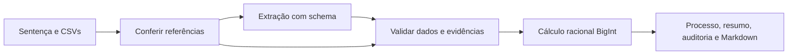

# S1.2 — uma condenação pelo Rivet

Registro da etapa indicada no título. Contagens de testes e pendências descrevem aquela rodada; mantenho o estado atual em [validação final](../entrega/validacao.md).
O grafo `analisar_carteira` recebe uma sentença e referências CSV, extrai dados pela OpenAI, valida evidências e produz `processos`, `resumo`, `auditoria` e `relatorio_markdown`. Toda interpretação e cálculo acontece no Rivet. Esta tarefa termina nesses quatro outputs; XLSX pertence à S1.3 e o executor integrado à S1.4.

## Implementação revisável

Os contratos [processo](../../schemas/processo.schema.json) e [resumo](../../schemas/resumo.schema.json) foram escritos antes da implementação. O schema de extração da S0 permanece canônico. Objetos não admitem propriedades extras e valores monetários usam centavos inteiros seguros.



- [preparar.js](../../rivet/code/s1/preparar.js): confere delimitadores, identidade, cabeçalhos, duplicatas, índices, subsídios, probabilidades e custo por tribunal. Um lote é rejeitado sem truncamento e referências inválidas detectáveis nesta etapa impedem a chamada à LLM.
- [Prompt](../../rivet/prompts/extracao-s1.txt): pede extração com evidências literais, sem delegar cálculo ao modelo. O Chat usa `json_schema` estrito; seu schema de transporte deriva do canônico. As restrições completas de calendário, limites numéricos e formato são aplicadas novamente pelo Ajv no grafo. Structured Outputs controla a estrutura, mas não garante fidelidade ao documento ([documentação oficial](https://developers.openai.com/api/docs/guides/structured-outputs?api-mode=chat)).
- [validar.js](../../rivet/code/s1/validar.js): reaproveita a validação semântica S0 e confere os componentes contra o dispositivo completo, impedindo que uma evidência recortada esconda dano concedido. Cruza mês-base, calcula meses completos e prepara parâmetros financeiros.
- O Code Node financeiro reaproveita [calculo-s0.js](../../rivet/code/calculo-s0.js), com frações BigInt e arredondamento explícito.
- [consolidar.js](../../rivet/code/s1/consolidar.js): valida as saídas pelos schemas, preserva extração original e memória, soma apenas recursos recomendados e explicita a premissa de reversão integral no relatório. Custo monetário não medido permanece `null`.

[build-s1.mjs](../../scripts/build-s1.mjs) compila os validadores dentro do projeto, sem imports em tempo de execução nos Code Nodes. Preserva o grafo anterior e torna `analisar_carteira` o principal. Os fontes legíveis são a origem das alterações: um novo build substitui esse grafo, inclusive edições manuais feitas nele pelo aplicativo.

## Evidências e resultados

Caso de desenvolvimento: `3871230-78.2024.8.26.0002`; referência `2026-05-31`.

| Saída | Resultado conferido |
| --- | ---: |
| Condenação original | R$ 6.300,00 |
| Principal corrigido | R$ 6.478,78 |
| Juros, 3 meses completos | R$ 194,36 |
| Valor atualizado | R$ 6.673,14 |
| Probabilidade / custo | 10% / R$ 3.200,00 |
| Benefício líquido esperado | -R$ 2.532,69 |
| Decisão econômica | não recorrer |

`npm test`: **14/14 aprovados**. `npm run test:s1:grafo`: **11/11 aprovados**, incluindo probabilidade alterada no CSV, schemas, lote, duplicata, custo/índice ausente, JSON inválido, data impossível, CNJ divergente, evidência inventada e componente omitido. O último teste reproduz a resposta real rejeitada, sem usar rede.

`npm run test:s1`: **1 aprovado e 1 falha**, saída 1. O teste externo do grafo agora passa com seus asserts originais; o XLSX continua falhando por ausência de `src/exportar-xlsx.mjs`, cuja implementação é a S1.3. `npm test` sozinho ainda não representa o aceite de toda a S1.

A primeira tentativa de rede no sandbox falhou com `EAI_AGAIN`. Depois de liberar a execução com rede, ocorreram duas avaliações, cada uma limitada a uma chamada real:

1. [Resposta rejeitada](../output/s1.2-llm-rejeitada.json): HTTP 200, mas identificação e fundamento juntavam trechos não contínuos. A validação impediu o cálculo; não houve flexibilização do contrato. Essa captura não registrou tokens, uma limitação corrigida no script para próximas falhas após extração.
2. [Resposta aprovada](../output/s1.2-llm-aprovada.json): após instruções mais específicas para as citações, os 10 campos comparados conferiram com o exemplo anotado e os sete campos de cálculo/decisão com o gabarito independente. Modelo `gpt-4.1-mini-2025-04-14`, temperatura 0, limite 2.500 tokens de saída; consumo informado pelo provedor: **1.116 entrada + 351 saída = 1.467 tokens**. Fundamento e evidências também foram inspecionados no documento. O hash registrado corresponde ao projeto entregue.

Essa avaliação usa um único caso de desenvolvimento e um prompt ajustado nele. Não mede acurácia da carteira nem desempenho em conjunto reservado. A resposta rejeitada permanece visível para não apresentar apenas a tentativa bem-sucedida.

## Como revisar

```bash
npm run s1:build
npm test
npm run test:s1:grafo
npm run test:s1
```

O último comando mantém a falha do exportador descrita acima. Os testes usam resposta simulada ou capturada, sem credencial e sem rede. Para repetir a avaliação real, configure `OPENAI_API_KEY` no `.env` local e execute `npm run s1:avaliar`. `LLM_MODEL` opcional substitui o modelo padrão; cada execução pode consumir créditos e guarda sua evidência em um diretório próprio de `outputs/s1.2/`.

No aplicativo, abra [analise_sentencas.rivet-project](../../rivet/analise_sentencas.rivet-project), selecione `analisar_carteira` e execute com os Graph Inputs padrão. Eles contêm somente o caso de desenvolvimento e as referências. Confira os quatro Graph Outputs e a tabela acima. Essa conferência no aplicativo ainda não foi realizada nesta tarefa; a execução validada aqui é pelo SDK real do Rivet.

## Limites desta fatia

Somente uma condenação, data-base do case e redação compatível com o lote fornecido. Outros resultados, ambiguidades e falhas encerram o grafo com erro; a representação dessas situações como pendências é trabalho da S2. Total agregado explícito também exige revisão nesta fatia. Os schemas admitem estados futuros, mas isso não implica que todos já tenham comportamento implementado.

O campo `tentativas: 1` indica uma extração sem ciclo de reparo. O avaliador limita chamadas HTTP e tempo; o aplicativo pode aplicar retries internos do SDK, ainda sem controle global de orçamento nesta fatia. Extração, custo desconhecido e limites de cobertura ficam explícitos na auditoria/documentação. Não foram implementados API, exportador, processamento dos 100 casos ou reorganização em subgrafos.
