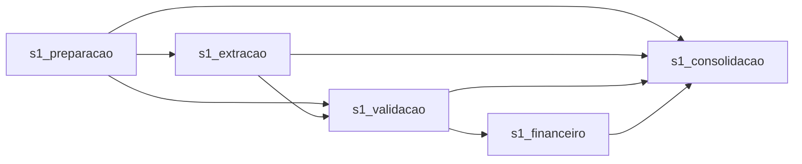

# S1.5 — subgrafos, regressão e aceite

Registro da etapa indicada no título. Contagens de testes e pendências descrevem aquela rodada; mantenho o estado atual em [validação final](../entrega/validacao.md).
S1.5 concluída. Confirmei nesta conversa a execução visual e a conferência pelo roteiro abaixo. Os arquivos locais foram reconferidos; [registro do aceite](../output/s1.5-aceite.json). Não foi localizada uma nova exportação do aplicativo: registrei minha conferência visual separadamente dos arquivos de replay examinados. Nenhuma nova chamada paga foi feita nesta tarefa.

## Organização do projeto

`analisar_carteira` mantém as sete entradas (seis textos de insumos/configuração e modelo) e os quatro outputs públicos. Agora contém somente Graph Inputs, chamadas de subgrafos e Graph Outputs:



| Subgrafo | Entradas | Saídas |
| --- | --- | --- |
| `s1_preparacao` | `processos_texto`, `subsidios_texto`, `indices_texto`, `custos_texto`, `probabilidades_texto`, `data_referencia`: strings | `preparado`: object; `sentenca`: string |
| `s1_extracao` | `sentenca`, `model`: strings | `response`: string; `usage`: object |
| `s1_validacao` | `preparado`: object; `resposta`: string | `base`, `extracao`, `parametros`: objects |
| `s1_financeiro` | `parametros`: object | `resultado`: object |
| `s1_consolidacao` | `base`, `extracao`, `calculo`, `preparado`, `uso`: objects; `resposta`, `modelo`: strings | `processos`, `auditoria`: object[]; `resumo`: object; `relatorio_markdown`: string |

O [build](../../scripts/build-s1.mjs) encapsula os nós existentes e transforma as conexões de fronteira em portas tipadas. Regras financeiras, prompt, schemas e validação semântica permanecem nos mesmos fontes. IDs dos nós internos foram mantidos, preservando a captura de resposta e consumo no executor. Os subgrafos propagam erros ao principal (`useErrorOutput: false`), evitando continuar com dados inválidos.

Os subgrafos recebem dados pelas portas; a execução completa deve começar por `analisar_carteira`, cujas entradas padrão continuam disponíveis. A geração preserva os demais grafos já existentes no projeto. Repetir `npm run s1:build` produziu o mesmo hash.

## Verificações executadas

Antes da refatoração, o novo teste de arquitetura falhou porque não existiam os cinco subgrafos; o teste de equivalência dos outputs já passou. Depois da mudança, ambos passaram. A equivalência compara os quatro outputs completos à captura aprovada da S1.2, ajustando somente `tokens` para `null`, pois replay não consome os tokens históricos.

`npm test` agora executa todas as seis suítes em sequência e interrompe no primeiro erro. A sequência evita concorrência entre testes que substituem o transporte global. Os comandos individuais continuam disponíveis:

| Suíte | Testes aprovados |
| --- | ---: |
| `test:s0` | 14 |
| `test:s1` | 2 |
| `test:s1:grafo` | 11 |
| `test:s1:xlsx` | 7 |
| `test:s1:execucao` | 7 |
| `test:s1:refatoracao` | 2 |
| Total | 43 |

Também foi executado:

```bash
npm run s1:executar -- --replay --destino outputs/s1.5
```

A execução passou pelos subgrafos e pelo exportador; os hashes dos artefatos foram conferidos e o XLSX foi reaberto, mantendo o valor atualizado de R$ 6.673,14. A [evidência local](../output/s1.5-validacao.json) registra o manifesto, resultados dos testes, hash do projeto e o aceite do aplicativo como pendente à época; o registro posterior de aceite está vinculado acima. Replay não avalia novamente a qualidade do modelo.

## Roteiro de conferência no aplicativo — confirmado por mim

Conferi o projeto manualmente no aplicativo e registrei o resultado. A inspeção automatizada examinou os arquivos de replay; não preservei uma nova exportação do aplicativo naquela rodada. Segui este roteiro:

1. Reabra `rivet/analise_sentencas.rivet-project` atualizado. Evite salvar sobre ele uma versão antiga que tenha ficado aberta.
2. Selecione `analisar_carteira`. Confira os cinco nós de subgrafo e abra cada subgrafo para verificar seus nós e portas.
3. Execute o principal com as entradas padrão e a chave configurada no Rivet. Isso faz uma chamada real à OpenAI.
4. Confira `processos`: CNJ `3871230-78.2024.8.26.0002`, valor atualizado `667314`, benefício `-253269`, decisão `nao_recorrer`.
5. Confira `resumo`: um processo apto, zero pendências, passivo `667314`, zero recursos recomendados.
6. Confira `auditoria`: evidências literais, índices `1086.2922` e `1117.1189` e memória de cálculo. No aplicativo, o consumo pode ser informado; no replay offline fica nulo.
7. Confira `relatorio_markdown`: data-base, processo, R$ 6.673,14 e recomendação de não recorrer. Informe esses resultados para registrar o aceite. Se ocorrer erro, preserve a mensagem e identifique o subgrafo.

O aplicativo produz os quatro Graph Outputs; a gravação do XLSX e dos arquivos de execução continua sendo responsabilidade do comando Node. Se uma nova resposta real for rejeitada pelo validador, a S1.5 deve continuar pendente até a ocorrência ser examinada; não se deve desabilitar a validação para obter aceite.

O aceite informado foi registrado em `docs/output/s1.5-aceite.json` e a S1.5 foi concluída no plano. Essa confirmação refere-se à versão S1.5, não à posterior S2.2. Os estados de erro e o limite de uma sentença continuam os da S1; S2 e processamento da carteira não haviam sido iniciados naquela rodada.

Commit sugerido para a refatoração local validada: `refactor: organiza pipeline S1 em subgrafos e unifica testes`.
